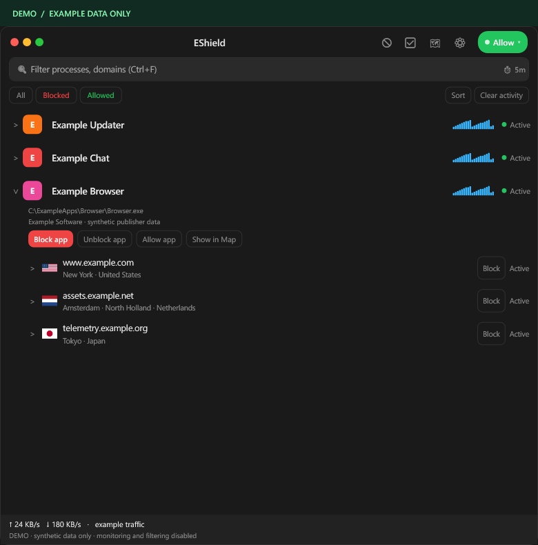
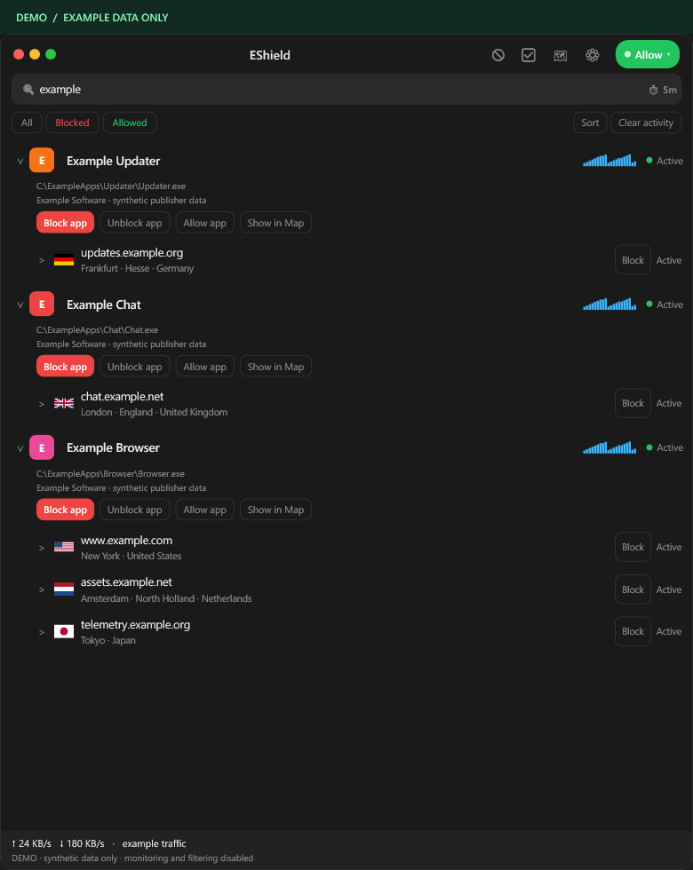
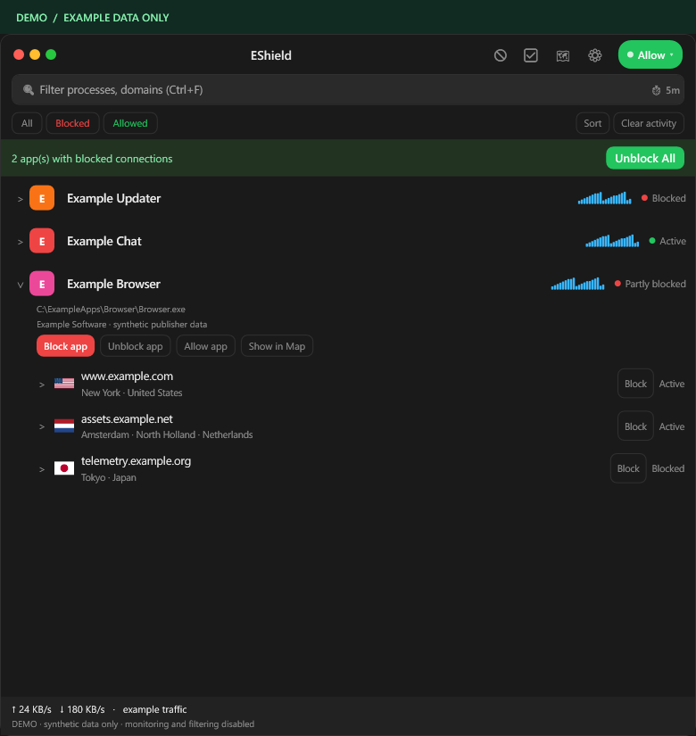
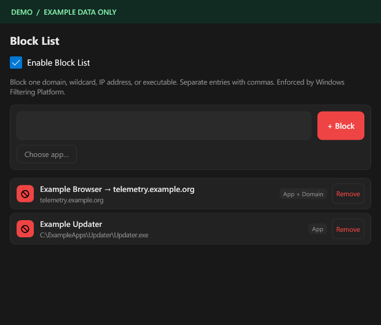
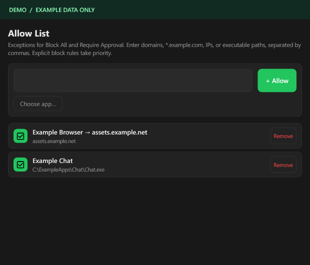
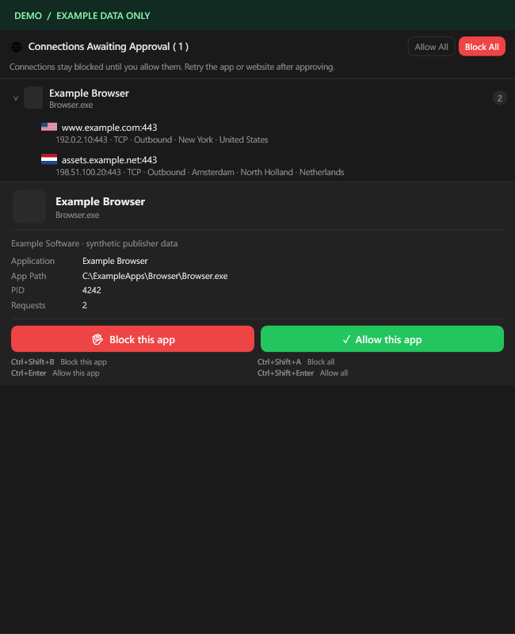
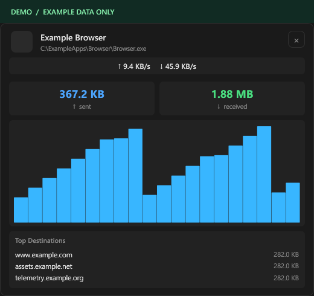
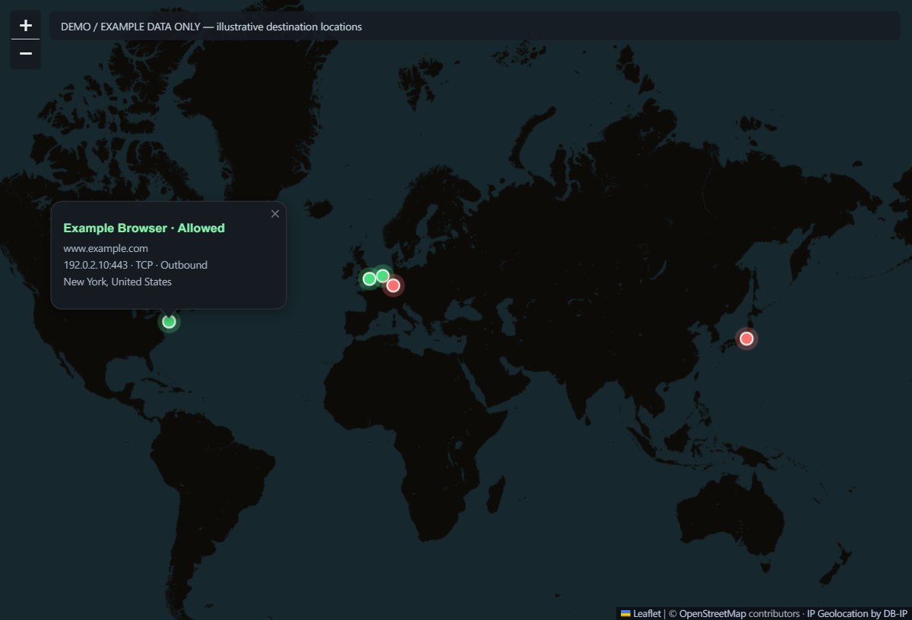
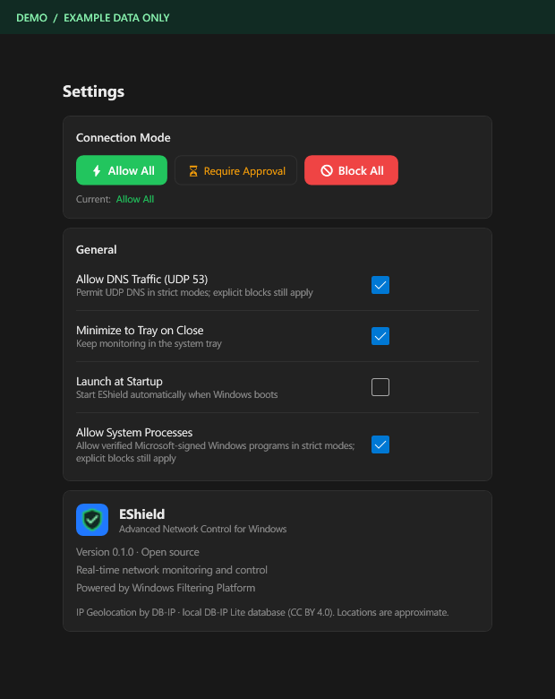

<p align="center">
  
</p>

<h1 align="center">EShield</h1>

<p align="center"><strong>A small, open-source take on TinyShield — built for Windows.</strong></p>

<p align="center">
  <a href="https://github.com/Mustafa1p/EShield/actions/workflows/windows.yml"></a>
  <a href="https://github.com/Mustafa1p/EShield/releases/latest"></a>
  <a href="LICENSE"></a>
  
</p>

See which apps connect to the internet, explore their destinations, and block an app or a specific destination. EShield combines a native Windows interface with Windows Filtering Platform, event-based network monitoring, and local GeoIP lookups.

**[Download for Windows](https://github.com/Mustafa1p/EShield/releases/latest)** · [Screenshots](#screenshots) · [Build from source](#build-from-source) · [Known limits](#known-limits)



> Every screenshot in this repository uses synthetic data. App names, executable paths, domains, traffic totals, and connection details are examples. Map coordinates illustrate the interface; documentation IP ranges do not identify those locations.

## What it does

| Feature | Behavior |
| --- | --- |
| App-level visibility | Group TCP and UDP traffic by the executable that created it, including IPv4 and IPv6. |
| Destination details | Inspect available hostnames, IPs, ports, direction, connection status, and approximate country, region, and city. |
| Search | Find apps, domains, IPs, or locations. Matching apps expand while keeping their observed destinations available. |
| Narrow blocking | Block an entire executable, or a domain/IP for one app. Destination rules retain both the app and remote-address conditions. |
| Block and Allow Lists | Manage executable, domain, wildcard, and IP rules. Add multiple entries or choose an executable with the file picker. |
| Connection modes | Use Allow All, Block All, or Require Approval, with configurable DNS and verified Windows-program exceptions. |
| GeoIP map | Explore destination countries and select a pin to reveal the matching app and connection in the list. |
| Bandwidth | View per-app transfer totals and recent traffic samples. |
| Local state | Store rules, settings, and bandwidth records on the device. Resolve GeoIP locations from a bundled local database. |

No account, subscription, license key, or GeoIP API key is required. This is an independent, early-stage project inspired by [TinyShield](https://tinyshield.proxyman.com/), with no affiliation or endorsement from TinyShield or Proxyman.

## Get started

1. Download the Windows x64 ZIP from [Releases](https://github.com/Mustafa1p/EShield/releases/latest).
2. Extract the **entire archive** into a folder. Keep `Data`, `Resources`, and the DLLs beside `EShield.exe`.
3. Run `EShield.exe` and accept Windows' administrator prompt. WFP filtering and ETW monitoring require elevation in this version.
4. Leave **Allow All** selected and open an app or website.
5. Expand the app to inspect destinations. Select a destination to expand its connection details.
6. Use the explicit **Block** button or right-click menu to block traffic. Selecting a row alone never blocks it.

The release ZIP includes the .NET runtime. [Microsoft Edge WebView2 Runtime](https://developer.microsoft.com/microsoft-edge/webview2/) is required for the map and is already present on many Windows systems.

Closing the main window can keep EShield in the tray. Monitoring and strict connection modes need the app to remain running. Explicit Block List rules are also saved to Windows Firewall and can remain active after quitting.

## Connection modes

| Mode | New connections | Explicit blocks |
| --- | --- | --- |
| **Allow All** | Continue without approval. | Stay active while the Block List is enabled. |
| **Require Approval** | Unknown connections are denied until an Allow List rule or configured exception permits them. Review the waiting app, path, signature information, and destinations. | Take priority over allow rules. |
| **Block All** | Denied unless an Allow List rule or configured exception permits them. | Take priority over allow rules. |

After approving an app, **retry its connection**. This version denies unknown connections; it does not hold and transparently resume the original network request.

Strict-mode WFP filters are tied to the application's lifetime. Windows releases those temporary filters if EShield exits. Explicit saved block rules remain separate from those temporary defaults.

## Screenshots

All views below are captured from real EShield controls using an isolated, fictional fixture. The **DEMO / EXAMPLE DATA ONLY** label is intentional.

### Search and destination blocking

Search expands matching apps without hiding their other destinations. Block one destination while keeping the rest of the app online.

| Search | App-scoped destination blocking |
| --- | --- |
|  |  |

### Block and Allow Lists

Review exactly which app or destination each rule targets. Wildcards such as `*.example.com` match subdomains.

| Block List | Allow List |
| --- | --- |
|  |  |

### Approval and bandwidth

Inspect a waiting app before deciding. Open an app's sparkline to explore its transfer totals and recent activity.

| Connection approval | App bandwidth |
| --- | --- |
|  |  |

### Destination map

Select a pin or app name in its popup to open the matching connection in the list. Right-click an app, domain, or IP to focus the map. The map updates as observed destinations change.



### Settings

Choose the connection mode, DNS exception, verified Windows-program exception, and tray behavior.



## Privacy and local data

- Rules, settings, bandwidth records, and diagnostic status are stored under `%LOCALAPPDATA%\EShield`.
- The connection list is maintained in memory during the running session. EShield is not a packet archive or HTTPS content recorder.
- Country, region, city, and coordinates are looked up locally using [DB-IP Lite](https://db-ip.com/db/lite.php). Monitored IPs are not uploaded to a GeoIP lookup service.
- Map tiles come from OpenStreetMap. Normal DNS resolution and reverse-DNS lookups may use the system's configured resolvers. These features require network access.
- Documentation images are generated from fictional fixtures, never from live traffic or a real desktop capture. Their provenance is recorded in [the screenshot manifest](docs/images/manifest.json).

**Before removing EShield:** select **Unblock All** if you also want to remove its explicit block rules, then quit the app and delete its extracted folder. Removing the executable alone does not remove saved Windows Firewall rules.

## Known limits

- Encrypted HTTPS page paths, request bodies, and responses are not visible. The list shows network destinations rather than every link on a webpage.
- Browsers using their own DNS over HTTPS, cached DNS data, shared hosting, and direct-IP connections can leave hostnames unavailable or ambiguous.
- Domain enforcement uses resolved and observed IP addresses. Other domains sharing a blocked IP can also be affected for the same app. Wildcard enforcement depends on observing matching names and their addresses.
- GeoIP is approximate and can identify a VPN, CDN, cloud region, or registered network rather than a person's physical location.
- Signature inspection uses Windows trust verification. Unsigned, catalog-only, inaccessible, or otherwise unverifiable executables may have limited signature information.
- Event availability and permissions vary across Windows installations. The status bar reports when event monitoring or filtering is unavailable.
- This version uses an elevated tray application, not a separately installed Windows service or custom kernel driver.

## Build from source

Requirements: Windows x64, PowerShell 7, .NET 9 SDK, and Visual Studio 2022 or newer with **Desktop development with C++** and a Windows SDK. Install WebView2 Runtime to use the map.

```powershell
git clone https://github.com/Mustafa1p/EShield.git
Set-Location EShield
pwsh -File tools/build.ps1 -Launch
```

The build script downloads a recent DB-IP Lite database if needed, compiles the native WFP module, and publishes to `artifacts/app`. The database is deliberately excluded from Git because it is large and distributed under a separate data license.

For a portable package containing the .NET runtime:

```powershell
pwsh -File tools/build.ps1 -SelfContained
```

### Tests and example screenshots

```powershell
# Isolated regression checks and a live WebView2 map interaction check
pwsh -File tools/test.ps1 -Map

# Run from an elevated terminal: isolated WFP and persistence checks
pwsh -File tools/test.ps1 -Native -Persistence

# Refresh every public screenshot using example data only
pwsh -File tools/capture-screenshots.ps1
```

Native tests check app/IP isolation, TCP, UDP, IPv4, IPv6, rule priority, and dynamic-session cleanup. Persistence tests use their own rule prefix and leave the user's EShield rules untouched. The external telemetry check is skipped if its baseline connection is unavailable.

## Project layout

```text
src/EShield.App/       WPF interface, ETW/DNS monitoring, rules, and local GeoIP
src/EShield.Native/    User-mode WFP management library
tests/                Regression, native integration, and screenshot fixtures
tools/                Build, test, database download, and screenshot scripts
docs/images/          Public screenshots containing synthetic data only
.github/workflows/    Windows CI and tagged release packaging
```

See [CONTRIBUTING.md](CONTRIBUTING.md) for development conventions. Visible feature changes should include refreshed example-only screenshots.

## License and acknowledgments

EShield source code is licensed under [MIT](LICENSE). Third-party code and datasets retain their own licenses; see [THIRD-PARTY-NOTICES.md](THIRD-PARTY-NOTICES.md).

GeoIP data: [DB-IP](https://db-ip.com/) under CC BY 4.0. Map data: [OpenStreetMap contributors](https://www.openstreetmap.org/copyright). Map rendering: [Leaflet](https://leafletjs.com/).
